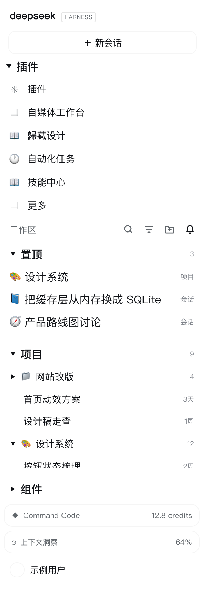
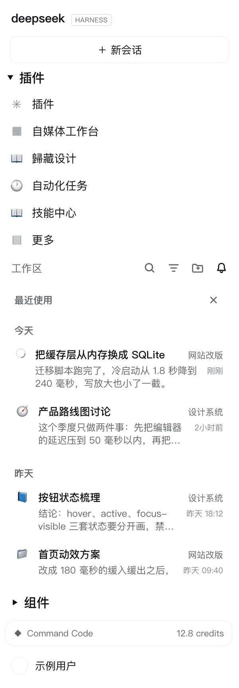

**English** | [简体中文](README.zh-CN.md)

# dsh-session-deck

**Manage your whole workspace, not just one conversation.** A Codex-style sidebar for DeepSeek Harness:
pin projects *and* conversations to one band, switch the sidebar to a "recently used" activity view,
give every project its own icon, and collapse the sections you are not using.

[](https://www.npmjs.com/package/dsh-session-deck)


## Screenshots

| Sidebar — pinned band, 项目 section, 组件 section | Activity view — the bell |
| --- | --- |
|  |  |

*(Rendered from the plugin's own stylesheet on the app's real theme tokens, with sample data — no
personal titles or paths appear in these images.)*

## Why

DSH's sidebar is organized per project, and that is fine until you work across several of them:

- the built-in pin only reorders a conversation **inside its own project** — there is no place for
  "these are the threads I am actually working on right now";
- the projects you use most sit wherever they happened to be created, and every project looks the same
  (one folder glyph);
- finding "what did I touch yesterday" means scrolling a tree;
- the bottom of the column fills up with widgets you cannot get out of the way.

This plugin adds the four things you reach for: **a pinned band, a recent view, an icon per project, and
collapsible sections.**

## What you get

| | |
| --- | --- |
| **Pinned band** (`置顶`) | Pin a conversation **or a whole project** into one band above every project. A pinned project unfolds in place and lists its own conversations — like the project row below, but reachable without scrolling. Click to open, `✕` to unpin, the header collapses. |
| **Activity view** (`🔔`) | The last icon of the workspace row switches the sidebar to **recently used**: day groups (today / yesterday / weekday / date), two lines per conversation (title + project, then **the beginning of the last answer**), a running indicator, and click-through that keeps the view open so you can walk through several threads in a row. |
| **Project icons** | Replace a project's folder icon with any emoji — on the sidebar's project rows *and* in the directory picker. A Codex-style picker: recently used, category tabs, an icon grid, and reset. |
| **One state everywhere** | Rename a conversation, finish a turn or change a project icon and every view follows: the pinned band and the activity view resolve each row against the live stores, and a working conversation shows the shell's own running ring. |
| **Collapsible sections** | `插件` (the panel nav rows), `置顶`, `项目` (the shipped project list) and `组件` (the sidebar's bottom widgets) each collapse from their own header and remember their state. |

## Sidebar anatomy

```
┌ 工作区                        🔍  ⌘  📁+  🔔   ← the bell opens the activity view
│ ▾ 置顶                                  3       ← pinned band (conversations + projects)
│   ▸ 🎨 设计系统                         项目
│     📘 把缓存层从内存换成 SQLite         会话
│     🌈 我没发现现在有什么这个左侧…      会话
│   ────────────────────────────────────
│ ▾ 项目                                  9       ← the shipped project list, collapsible
│   📁 pdf
│   🚀 前沿方向研究
│       首页动效方案                      3天
└
  ⋯ widgets ⋯
  ▸ 组件                                          ← the bottom widgets, collapsible
```

## Usage

1. **Pin** — hover a conversation row and press `☆` in its action strip, or hover a project row and
   press the `☆` left of the pencil. The pinned band appears on top; its header collapses it and `✕`
   removes a single pin.
2. **Recent** — press the bell at the end of the workspace row. Pick a conversation; the view stays
   open, so you can pick several. Press the bell again (or `✕`) to return to the project list.
3. **Icons** — hover a project row and press the pencil (or right-click the row) to open the picker.
   Pick an emoji, paste one from the system emoji panel (⌃⌘Space), or reset to the folder glyph. The
   same picker works on the folder rows inside the directory picker.
4. **Collapse** — click any section header (`置顶` / `项目` / `组件`). States are remembered per DSH home.

## Install

```bash
# from npm — also available in the in-app "add plugin" dialog by name
dsh plugin --profile desktop add dsh-session-deck

# or straight from this repository (no npm)
dsh plugin --profile desktop add github:Timebro9999/dsh-session-deck
```

Restart the desktop app (or reload the window) once; after that the plugin loads with the profile.
The same spec works in the in-app plugin pages (they accept a GitHub target), and `#v0.1.1` pins a
release instead of tracking `main`:

```bash
dsh plugin --profile desktop add github:Timebro9999/dsh-session-deck#v0.1.1
```

Listing in the DSH plugin market comes from the curated index
[`awesome-dsh-plugin`](https://github.com/awesome-dsh-plugin/awesome-dsh-plugin) (the market reads its
`plugins.json`). The submission is one file — `data/plugins/Timebro9999__dsh-session-deck.yml`, kept in
this repo under [`marketplace/`](marketplace) — and
[`scripts/open-marketplace-pr.sh`](scripts/open-marketplace-pr.sh) opens the PR.

## Host requirements

| | |
| --- | --- |
| **DSH host** | `0.2.0-rc.1` (verified live) or `0.1.7-rc.2`; the same bundle runs in the desktop app and in the web client |
| **Profile** | any profile — the examples use `desktop` |
| **Host Node** | `^22.19.0` or `>=24` (whatever DSH ships; the plugin needs nothing beyond it) |
| **Runtime dependencies** | none — `lib/client.js` is plain CommonJS over the DOM, loaded as-is, **no build step** |
| **Client services** | none required (`inject: []`). `sessions`, `workspaces`, `uiWorkspace` and `locale` are used when they exist; without them the plugin still paints, just with less data |
| **Browser APIs** | `localStorage`, `MutationObserver`, `requestAnimationFrame`, `Intl.Segmenter` |
| **Platform** | macOS, Windows, Linux — browser-side only, no native code (the icon picker's hint prints the emoji-panel shortcut for the OS it runs on) |
| **Network** | none at runtime (no telemetry, no remote calls) |
| **What it binds to** | the shipped sidebar's DOM: `[data-row-key^="workspace:"]` / `[data-row-key^="session:"]` rows, the section header, the list scroller and the foot area. A future shell redesign can move these anchors — that is the one thing an upgrade can break |
| **Storage** | browser `localStorage` only (`dsh-session-deck:v1`, `dsh-session-deck:previews:v3`) |

The interface follows DSH's own language (the locale service first, then the rendered UI, then the
browser), so its copy is Chinese or English like the rest of the app.

## How it works

The plugin registers **no slot** and requires **no client service** (`inject: []`). It mounts a DOM
overlay: it finds the shipped rows (`[data-row-key^="workspace:"]`, `session:`), the section header, the
list scroller and the sidebar foot area; adds controls styled from the row's own buttons; and paints the
states the shell does not offer. Anything it needs beyond the DOM comes from client services it reads on
demand (`ctx.get('sessions' | 'workspaces' | 'uiWorkspace' | 'locale')`).

Every node it inserts is marked `data-dsh-session-deck`, so a later mount reclaims its predecessor's
leftovers — the shell does not unload an old client instance when it reloads a bundle. The working
notebook of that exploration (anchors, mirrored CSS, traps, and the remote probe that reports page state
through a slot id) lives in [`docs/implementation.md`](docs/implementation.md) (Chinese).

## Storage

Everything is browser `localStorage`, per DSH home:

| Key | Contents |
| --- | --- |
| `dsh-session-deck:v1` | `{ emoji, recent, pinnedSessions, pinnedProjects, expandedProjects, pinnedCollapsed, workspaceCollapsed, widgetsCollapsed }` |
| `dsh-session-deck:previews:v3` | The answer preview of each conversation, keyed by its `updatedAt` stamp |

Project icons are stored under two keys on purpose — the workspace id when a surface knows it, and
`name:<basename>` when only the folder name exists — and either resolves everywhere.

## Development

```bash
npm test        # 148 + 7 assertions, no dependencies
```

The suite boots the real `lib/client.js` under a fake module loader with a fake DOM, a fake client
context and fake session records, then drives every surface: registrations, painted icons, triggers, the
picker, the pinned band, the sections, the activity view (including which part of a message becomes the
preview), locale handling, and unload/reload safety. CI runs it on Node 22 and 24.

## Uninstall

```bash
dsh plugin --profile desktop remove dsh-session-deck
```

There is no host-side state: remove it, reload, and the shell is exactly as it was.

## License

MIT
